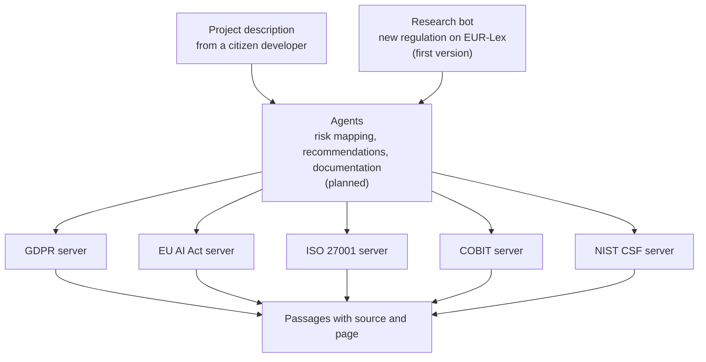
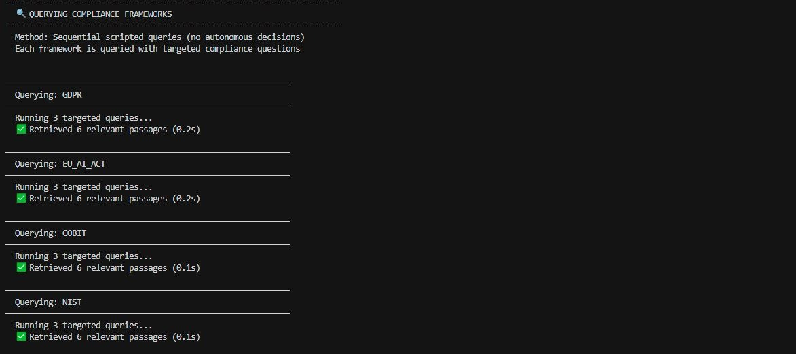
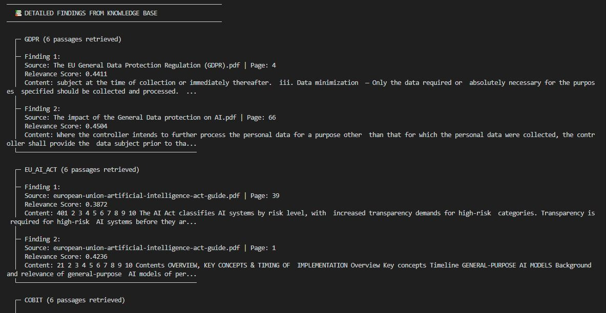
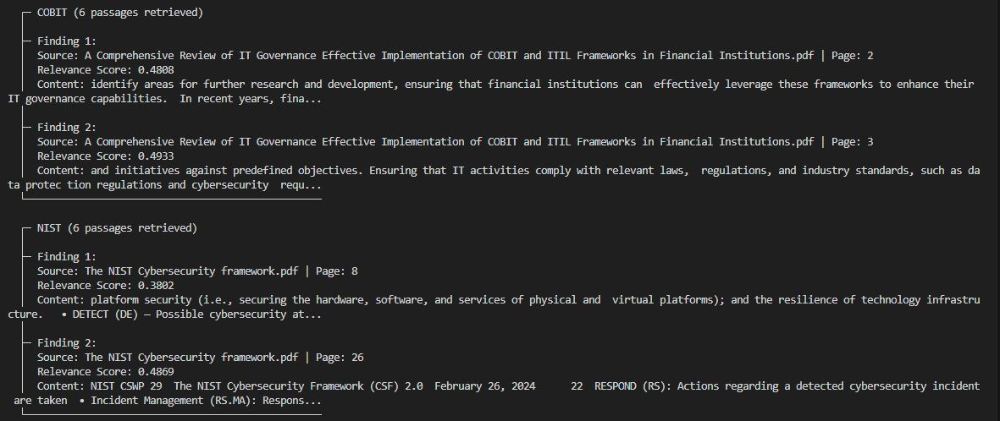

# vCOO: a virtual compliance officer for citizen developers

Someone builds a small digital product with no-code tools and generative AI. Which rules apply to it? This project is a first step towards a system that answers that question from the regulatory texts themselves, with the source and page for every passage.

**Status: the knowledge layer and a scripted prototype are built. The agent layer is planned.** I built this as a research assistant at HfWU Nürtingen-Geislingen in early 2026. This page describes the work. The code is not published here.

## The problem

Citizen developers are people without a technical or legal background who now build real applications. Their product may collect personal data, use an AI model, or run on public money. Each of these triggers a different set of rules:

- **Data protection law** as soon as personal data is collected
- **The EU AI Act** as soon as an AI system makes or prepares decisions
- **Security and governance frameworks** as soon as the product runs in an organisation

These rules sit in separate documents, written for specialists. A person who builds an app in an afternoon does not know which of them to open.

## The idea

A compliance officer that a non-expert can ask. It should do three things:

1. **Find** the passages that apply to a described project, in each framework.
2. **Show the source** for each passage, so that a person can check it.
3. **Stay current**, by watching for new regulation.

## Design decision: one server per framework

The planned system has several agents: one maps risks, one writes recommendations, one documents. If every agent had its own copy of every regulation, the same documents would be indexed many times, and an update would have to be made in many places.

I used the Model Context Protocol (MCP) to avoid this. Each framework is one server. Every agent asks the same server.

One update to a framework's documents then reaches every agent at once.

## What I built

### 1. The knowledge layer: five MCP servers

| Server | Framework | What it covers for a citizen developer |
|---|---|---|
| GDPR | General Data Protection Regulation | Collecting and storing personal data, consent |
| EU AI Act | Regulation (EU) 2024/1689 | Risk class of an AI system, transparency duties |
| ISO 27001 | Information security management | Security controls and risk assessment |
| COBIT | IT governance | Controls, audit trails, data governance |
| NIST CSF | Cybersecurity Framework 2.0 | Identify, protect, detect, respond, recover |

Each server works the same way:

1. It loads the PDF documents of its framework.
2. It splits them into passages of about 1,000 characters with an overlap of 200.
3. It turns each passage into a vector with a local embedding model (BAAI/bge-small-en-v1.5), so no text leaves the machine and there is no cost per query.
4. It stores the vectors in a FAISS index.
5. It offers one tool to MCP clients: ask a question, get the closest passages back with file name and page number.

Each server has a small test script with three questions, and one master script queries all five.

### 2. The scripted prototype

Before giving any agent freedom to decide, I wanted to see the knowledge layer work from start to finish on one real case. So the prototype is a script with a fixed order and no autonomous decisions.

**The test case** comes from a student project in the same research group: an AI adviser for mobility planning in a small German town. I chose it because it touches every framework at once.

| What the adviser does | Framework it triggers |
|---|---|
| Collects GPS and sensor data from citizens through an app | GDPR |
| Builds mobility patterns of individual people | GDPR, automated processing |
| Recommends infrastructure measures that use public money | EU AI Act, possible high-risk system |
| Runs on live data streams and a public app | NIST CSF, ISO 27001 |
| Handles citizen data inside a public body | COBIT |

For each framework I wrote three questions, the way a compliance officer would ask them. For example, for GDPR: "GPS location data collection from citizens, personal data, consent requirements".

### 3. A first research bot

A module that looks for new regulation on EUR-Lex, the EU's legal database, and filters the results by keywords such as "artificial intelligence", "data protection" and "cybersecurity". If the live search fails, it falls back to a stored list of five known updates, each with its official link.

## The test run

Run on 28 February 2026.

| Framework | Questions | Passages returned | Time |
|---|---|---|---|
| GDPR | 3 | 6 | 0.2 s |
| EU AI Act | 3 | 6 | 0.2 s |
| COBIT | 3 | 6 | 0.1 s |
| NIST CSF | 3 | 6 | 0.1 s |
| ISO 27001 | 3 | 0 | no result |
| **Total** | **15** | **24** | |

Four of five frameworks answered. Every passage came back with its source file and page.

## What did not work, and why

### The ISO server returned nothing

The cause was a naming mismatch, not the search. The ISO 27001 server stores its index in one folder. The prototype script looked for it under a different folder name. The folder was not found, so no question reached the index.

The script reported this correctly as "no results, check vector store" and went on. It is a one-line correction. I leave the result as it was in the run.

### The research bot never reached EUR-Lex

Every live request failed. The links it had read from the EUR-Lex page were relative and could not be opened, and the search address returned "not found". The bot then used its stored list.

So the five updates in the report were the stored ones, not live results. The output said so: "FALLBACK mode". The fallback did what it was built for, but the live part is not yet working.

### The retrieved passages are close, not always on point

Looking at what came back:

- **Some sources are secondary.** For COBIT, the indexed document is an academic review paper about COBIT, not the framework itself. For the EU AI Act, part of it is a guide. The passages are about the right subject but are not the binding text.
- **Some passages are fragments.** One EU AI Act result is a table of contents. Splitting by character count cuts through headings and lists.
- **Nothing was scored.** The run shows that passages come back. It does not show how many of them a compliance expert would call relevant.

### The risk levels were not generated

The report prints a risk level per framework (GDPR high, EU AI Act high, NIST medium and so on) and a list of recommended actions. I wrote these into the script by hand, as a picture of what the planned agents should produce. They do not change with the search results. In this version, only the retrieved passages come from the system.

## What I take from it

- **Building bottom-up paid off.** Because the prototype had a fixed order and no agent, both failures were visible at once and easy to trace. In an autonomous system, a missing index would have surfaced much later, as a vague or invented answer.
- **A fallback must say that it is one.** The research bot labelled its stored list. Without that label the report would have looked live.
- **A system that names its source can be checked.** Each passage carries file and page. That is how I could see that the COBIT source was a review paper.
- **The quality of the answer is set by the documents.** The search can only return what was indexed. Choosing primary texts matters more than tuning the model.

## Planned next

| Step | Content |
|---|---|
| Fix and re-run | Correct the ISO path and the EUR-Lex requests, run the scenario again |
| Better sources | Index the binding texts where they are freely available, and split by article instead of by character count |
| Evaluation | Have retrieved passages rated by a compliance expert. Targets: more than 80% agreement, report in under 60 seconds |
| More cases | Run several citizen developer scenarios, not one |
| Agent layer | LangGraph agents for risk mapping, recommendations and documentation, with a person approving the result |

## Built with

Python, MCP (FastMCP), LangChain, FAISS, HuggingFace sentence embeddings (BAAI/bge-small-en-v1.5), Requests and BeautifulSoup for the research bot.

## Notes

- This page is a description of my work on a university research project. The code and the regulatory documents are not part of this repository. ISO and COBIT texts are licensed and may not be redistributed.
- The system is a research prototype. Its output is not legal advice.

Author: Abdul Rehman, [github.com/meet-rehman](https://github.com/meet-rehman)
